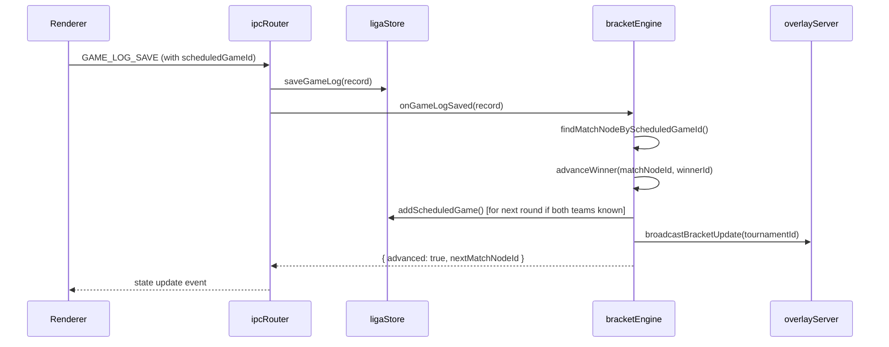
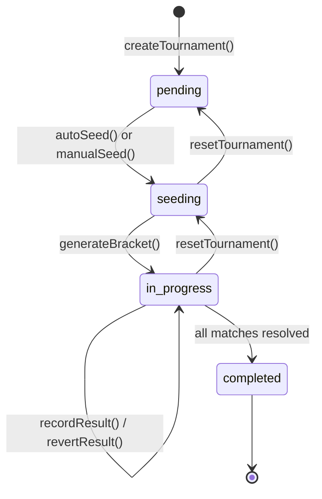

# Design Document: Tournament Bracketing

## Overview

The Tournament Bracketing feature adds tournament management capabilities to the existing LigaControl basketball scoreboard application. It introduces a new main-process module (`bracketEngine.ts`) that handles bracket creation, seeding, structure generation, match progression, and persistence. On the renderer side, a `BracketViewer` component renders bracket trees/grids visually. The system integrates with the existing `ligaStore` (teams, game logs, schedules), `overlayServer` (real-time WebSocket broadcasts), `roleStore` (RBAC), and `exportService` (PDF generation).

### Key Design Decisions

1. **Separate module, not embedded in ligaStore**: Tournament state is complex (tree/graph structures) and benefits from its own persistence and logic module. The `bracketEngine` interacts with `ligaStore` for team data, game logs, and schedule entries but maintains its own JSON files for bracket state.

2. **Pure-function bracket generation**: Bracket generation algorithms (single-elim, double-elim, round-robin) are implemented as pure functions for testability, with side-effects (persistence, broadcasting) handled at the store boundary.

3. **Event-driven progression**: When a game log is saved that is linked to a Match_Node, the bracket engine auto-advances the bracket. This is triggered via a hook in the IPC layer rather than polling.

4. **Existing IPC pattern**: New tournament commands use the same `scoreboard:query` invoke pattern for queries and a new `TOURNAMENT` action category for RBAC enforcement.

## Architecture

```mermaid
graph TB
    subgraph Renderer Process
        CP[Control Panel App.tsx]
        BV[BracketViewer Component]
        TM[TournamentManager Component]
    end

    subgraph Main Process
        IR[ipcRouter.ts]
        BE[bracketEngine.ts]
        LS[ligaStore.ts]
        OS[overlayServer.ts]
        RS[roleStore.ts]
        ES[exportService.ts]
    end

    subgraph Persistence
        TF[tournaments/{ligaId}/{tournamentId}.json]
        LF[ligas/{ligaId}.json]
    end

    subgraph External
        WS[WebSocket Clients / Overlay]
    end

    CP --> IR
    TM --> IR
    BV --> IR
    IR --> BE
    IR --> RS
    BE --> LS
    BE --> OS
    BE --> ES
    BE --> TF
    LS --> LF
    OS --> WS
```

### Integration Points

| Existing Module | Integration |
|---|---|
| `ligaStore` | Read teams/players for seeding; read game logs for auto-seeding rankings and match results; create/update ScheduledGame entries for bracket matches |
| `overlayServer` | Broadcast bracket state updates via WebSocket using a new `bracket` message type |
| `roleStore` | New `TOURNAMENT` action category added to RBAC permission matrix |
| `ipcRouter` | New query types for tournament CRUD, seeding, advancement, export |
| `exportService` | Extended with bracket PDF generation using jsPDF |
| `gameStore` | No direct integration — bracket engine observes game log saves, not live game state |

### Data Flow: Match Result → Auto-Advance



## Components and Interfaces

### bracketEngine.ts (Main Process Module)

```typescript
export interface BracketEngine {
  // Tournament lifecycle
  createTournament(ligaId: string, name: string, format: BracketFormat): Tournament;
  deleteTournament(tournamentId: string): void;
  resetTournament(tournamentId: string): Tournament;

  // Seeding
  autoSeed(tournamentId: string): SeedResult;
  manualSeed(tournamentId: string, teamIds: string[]): SeedResult;

  // Bracket generation
  generateBracket(tournamentId: string, options?: BracketOptions): Tournament;

  // Match progression
  recordResult(tournamentId: string, matchNodeId: string, homeScore: number, awayScore: number): AdvanceResult;
  revertResult(tournamentId: string, matchNodeId: string): RevertResult;
  onGameLogSaved(record: GameLogRecord): AdvanceResult | null;
  onGameLogDeleted(ligaId: string, logId: string): RevertResult | null;

  // Queries
  getTournament(tournamentId: string): Tournament;
  listTournaments(ligaId: string): TournamentSummary[];
  getActiveTournament(ligaId: string): Tournament | null;

  // Export
  exportBracketPdf(tournamentId: string, destPath: string): Promise<void>;

  // Real-time
  broadcastBracketState(tournamentId: string): void;
  getFullBracketPayload(tournamentId: string): BracketPayload;
}
```

### BracketViewer (Renderer Component)

```typescript
interface BracketViewerProps {
  tournamentId: string;
  ligaId: string;
}

// Sub-components:
// - SingleElimTree: Left-to-right tree with SVG connecting lines
// - DoubleElimView: Winners bracket + Losers bracket + Grand Final sections
// - RoundRobinGrid: Matrix grid with scores in cells
// - MatchCard: Individual match node display (teams, seeds, scores, status)
// - BracketHeader: Tournament name, format badge, status
```

### TournamentManager (Renderer Component)

```typescript
interface TournamentManagerProps {
  ligaId: string;
}

// Tabs/views:
// - Tournament list (create, delete, open)
// - Seeding panel (auto/manual seed, drag-reorder)
// - Active bracket view (delegates to BracketViewer)
// - Export panel (PDF, print)
```

### IPC Query Extensions

New query types added to the `QueryMessage` union in `ipcRouter.ts`:

```typescript
// Tournament queries
| { type: 'TOURNAMENT_CREATE'; ligaId: string; name: string; format: BracketFormat }
| { type: 'TOURNAMENT_DELETE'; tournamentId: string }
| { type: 'TOURNAMENT_RESET'; tournamentId: string }
| { type: 'TOURNAMENT_LIST'; ligaId: string }
| { type: 'TOURNAMENT_LOAD'; tournamentId: string }
| { type: 'TOURNAMENT_AUTO_SEED'; tournamentId: string }
| { type: 'TOURNAMENT_MANUAL_SEED'; tournamentId: string; teamIds: string[] }
| { type: 'TOURNAMENT_GENERATE_BRACKET'; tournamentId: string; options?: BracketOptions }
| { type: 'TOURNAMENT_RECORD_RESULT'; tournamentId: string; matchNodeId: string; homeScore: number; awayScore: number }
| { type: 'TOURNAMENT_REVERT_RESULT'; tournamentId: string; matchNodeId: string }
| { type: 'TOURNAMENT_EXPORT_PDF'; tournamentId: string }
| { type: 'TOURNAMENT_PRINT'; tournamentId: string }
```

### RBAC Extension

New action category added to `ActionCategory` type:

```typescript
export type ActionCategory =
  | 'SCORING' | 'CLOCK' | 'FOULS' | 'TIMEOUTS' | 'PLAYER_STATS'
  | 'LIGA_CONFIG' | 'USER_MGMT' | 'SYSTEM' | 'VIEWER' | 'STREAMING'
  | 'TOURNAMENT';  // NEW

// Permission matrix additions:
// Admin:       full TOURNAMENT access (create, delete, reset, seed, advance, export)
// Scorekeeper: TOURNAMENT access (seed, advance, record results, export)
// Coach:       read-only (list, load, view)
// Viewer:      read-only (list, load, view)
```

### WebSocket Message Extension

New bracket message type for the overlay server:

```typescript
// Outgoing WS messages now include:
| { type: 'state'; data: OverlayState }       // existing
| { type: 'config'; data: OverlayConfig }     // existing
| { type: 'bracket'; data: BracketPayload }   // NEW
| { type: 'bracket-update'; data: BracketUpdatePayload }  // NEW (incremental)
```

## Data Models

### Tournament

```typescript
export type BracketFormat = 'single-elimination' | 'double-elimination' | 'round-robin';
export type TournamentStatus = 'pending' | 'seeding' | 'in-progress' | 'completed';

export interface Tournament {
  id: string;                    // unique identifier (UUID)
  ligaId: string;                // owning Liga
  name: string;                  // 1-100 chars, trimmed
  format: BracketFormat;
  status: TournamentStatus;
  createdAt: string;             // ISO 8601
  updatedAt: string;             // ISO 8601

  // Seeding
  seeds: TournamentSeed[];       // ordered by seed number (1-based)

  // Bracket structure
  rounds: Round[];               // ordered array of rounds
  matchNodes: MatchNode[];       // all match nodes in flat array (referenced by id)

  // Double-elimination specific
  winnersBracket?: Round[];      // Winners bracket rounds
  losersBracket?: Round[];       // Losers bracket rounds
  grandFinal?: MatchNode;        // Grand final match

  // Round-robin specific
  standings?: RoundRobinStanding[];

  // Result
  championTeamId?: string;       // set when status = 'completed'

  // Options
  options: BracketOptions;
}

export interface BracketOptions {
  consolationMatch: boolean;     // 3rd place match for single-elim (default false)
}

export interface TournamentSummary {
  id: string;
  name: string;
  format: BracketFormat;
  status: TournamentStatus;
  createdAt: string;
  teamCount: number;
  championTeamId?: string;
}
```

### TournamentSeed

```typescript
export interface TournamentSeed {
  seedNumber: number;            // 1-based position
  teamId: string;                // reference to LigaTeam.id
  teamName: string;              // denormalized for display
  record: { wins: number; losses: number };  // at time of seeding
  pointDifferential: number;     // total points scored - allowed
}
```

### MatchNode

```typescript
export type MatchNodeStatus = 'pending' | 'scheduled' | 'in-progress' | 'completed' | 'bye';

export interface MatchNode {
  id: string;                    // unique within tournament
  roundIndex: number;            // which round this match belongs to
  position: number;              // position within the round (0-based)
  bracketSection: 'winners' | 'losers' | 'final' | 'consolation' | 'round-robin';

  // Participants
  homeTeamId: string | null;     // null when TBD (waiting for feeder match)
  awayTeamId: string | null;     // null when TBD or BYE
  homeSeed: number | null;
  awaySeed: number | null;

  // Source: which matches feed into this one
  homeSourceMatchId: string | null;   // match whose winner becomes home
  awaySourceMatchId: string | null;   // match whose winner becomes away
  homeSourceIsLoser: boolean;         // true in losers bracket (takes loser of source)
  awaySourceIsLoser: boolean;

  // Result
  status: MatchNodeStatus;
  homeScore: number | null;
  awayScore: number | null;
  winnerTeamId: string | null;
  loserTeamId: string | null;

  // Schedule integration
  scheduledGameId: string | null;     // link to Liga's ScheduledGame
  gameLogId: string | null;           // link to saved game log

  // BYE handling
  isBye: boolean;                     // true when awayTeamId is null due to BYE
}
```

### Round

```typescript
export interface Round {
  index: number;                 // 0-based round number
  name: string;                  // e.g. "Round of 16", "Quarterfinals", "Semifinals", "Final"
  matchNodeIds: string[];        // ordered match node IDs in this round
}
```

### RoundRobinStanding

```typescript
export interface RoundRobinStanding {
  teamId: string;
  teamName: string;
  played: number;
  wins: number;
  losses: number;
  pointsFor: number;
  pointsAgainst: number;
  pointDifferential: number;
}
```

### BracketPayload (WebSocket)

```typescript
export interface BracketPayload {
  tournamentId: string;
  name: string;
  format: BracketFormat;
  status: TournamentStatus;
  seeds: TournamentSeed[];
  matchNodes: MatchNode[];
  rounds: Round[];
  winnersBracket?: Round[];
  losersBracket?: Round[];
  grandFinal?: MatchNode;
  standings?: RoundRobinStanding[];
  championTeamId?: string;
}

export interface BracketUpdatePayload {
  tournamentId: string;
  updatedMatchNodes: MatchNode[];       // only the changed nodes
  newScheduledGames?: string[];         // IDs of newly created scheduled games
  status: TournamentStatus;
  championTeamId?: string;
}
```

### Persistence File Structure

```
{userData}/
  tournaments/
    {ligaId}/
      {tournamentId}.json    ← full Tournament object serialized as JSON
```

Each tournament is a single JSON file. The `bracketEngine` reads/writes these files synchronously (same pattern as `ligaStore`). File size for a 64-team double-elimination bracket is ~50KB — well within reasonable limits for synchronous I/O.

## Bracket Generation Algorithms

### Single-Elimination

1. Determine number of rounds: `ceil(log2(teamCount))`
2. Calculate BYEs needed: `nextPowerOfTwo(teamCount) - teamCount`
3. Place seeds using "fold" pattern so seed 1 faces seed N, seed 2 faces seed N-1, etc. in different halves of the draw
4. Assign BYEs to highest seeds (lowest seed numbers)
5. Create MatchNode for each contest; mark BYE matches as completed with the seeded team as winner
6. Wire `homeSourceMatchId` / `awaySourceMatchId` for subsequent rounds

### Double-Elimination

1. Generate Winners_Bracket using same seeded placement as single-elimination
2. Generate Losers_Bracket rounds: after each Winners_Bracket round, losers drop into the Losers_Bracket
3. Losers_Bracket has approximately `2 * (winnersRounds - 1)` rounds (alternating "drop-down" rounds and "play" rounds)
4. Grand Final: Winners_Bracket champion vs Losers_Bracket champion
5. Wire source matches with `homeSourceIsLoser` / `awaySourceIsLoser` flags

### Round-Robin

1. Use the "circle method" for scheduling: fix team 1, rotate remaining teams
2. For N teams: `N-1` rounds (if N is even) or `N` rounds (if N is odd, add a BYE placeholder)
3. Each round has `floor(N/2)` matches
4. No advancement — results feed into the standings table

## State Management and Persistence Strategy

### Persistence

- **Format**: JSON files, one per tournament
- **Location**: `{userData}/tournaments/{ligaId}/{tournamentId}.json`
- **Write strategy**: Full tournament state written on every mutation (same pattern as ligaStore)
- **Write timing**: Synchronous, within 1 second of change (per Requirement 7.1)
- **Startup restore**: On app launch, `bracketEngine.init()` scans the tournaments directory and loads valid files
- **Error handling**: Malformed JSON files are excluded from listings, logged as warnings, and not deleted

### State Transitions



### Concurrency

The application is single-user per instance (Electron desktop app). No concurrent write conflicts are expected. The bracket engine holds no in-memory cache — it reads from disk on each operation to ensure consistency after crashes.

## PDF Export Approach

The existing `exportService.ts` uses `jsPDF` for PDF generation. The bracket export extends this with:

1. **Layout engine**: A recursive function computes x/y positions for each MatchNode in the bracket tree
2. **Rendering**: Uses jsPDF drawing primitives (rectangles, lines, text) to render match cards and connecting lines
3. **Scaling**:
   - ≤16 teams: single landscape page (A4 or Letter)
   - >16 teams: paginated across multiple landscape pages with continuation markers
4. **Content per MatchNode**: Team name, seed number, score (or "TBD" if pending)
5. **Header**: Tournament name, creation date, format badge
6. **Round-robin**: Rendered as a table/matrix with column and row headers

## Real-Time Update Flow via WebSocket

### Bracket Broadcast

The overlay server is extended to handle bracket messages alongside game-state messages:

```typescript
// In overlayServer.ts — new method:
broadcastBracket(payload: BracketPayload | BracketUpdatePayload): void {
  const message = JSON.stringify({
    type: payload.hasOwnProperty('updatedMatchNodes') ? 'bracket-update' : 'bracket',
    data: payload,
  });
  for (const client of wss.clients) {
    if (client.readyState === WebSocket.OPEN) {
      try { client.send(message); } catch { /* skip failed client */ }
    }
  }
}
```

### Client Connection Flow

1. Client connects to WebSocket at `/ws`
2. Server sends current game state (`type: 'state'`)
3. If a tournament with status `in-progress` exists for the active Liga, server sends full bracket state (`type: 'bracket'`)
4. On match result updates, server sends incremental update (`type: 'bracket-update'`) containing only changed match nodes

### Latency Budget

- Game log saved → bracket advanced → WebSocket broadcast: target < 2 seconds total
- This is achievable since bracket advancement is synchronous computation (< 10ms) and JSON serialization of the bracket payload is < 5ms for 64 teams

## Error Handling

| Scenario | Handling |
|---|---|
| Liga ID not found | Return error message, no state change |
| Invalid tournament name | Return validation error with reason |
| Unsupported bracket format | Return error listing valid formats |
| Fewer than 2 teams seeded | Return error indicating minimum |
| Duplicate team IDs in seed list | Return error indicating duplicates |
| Team ID not in Liga | Return error listing invalid IDs |
| Tied game score | Do not advance; emit event requiring OT/tiebreaker |
| Game log deleted after advancement | Revert match node + clear downstream; reset linked ScheduledGame |
| Corrupt tournament JSON on disk | Exclude from listing, log warning, do not crash |
| PDF generation failure | Return error, clean up partial file |
| WebSocket send failure | Skip client, continue broadcast to others |
| Tournament not found by ID | Return "not found" error |
| Unauthorized role | Return "access denied" error, no state mutation |
| More than 64 teams | Return error indicating maximum |

## Testing Strategy

### Unit Tests (Vitest)

Unit tests cover:
- Bracket generation correctness (single-elim, double-elim, round-robin)
- Seeding algorithms (auto-seed ranking, tiebreakers, BYE assignment)
- Match advancement logic (winner advances, loser to losers bracket, elimination)
- Result reversion and downstream cleanup
- Validation edge cases (empty name, too few teams, invalid format, duplicate IDs)
- RBAC enforcement for tournament commands
- WebSocket payload construction

### Property-Based Tests (fast-check)

Property-based testing is highly applicable to this feature because:
- Bracket generation produces data structures with universal invariants (correct team count, no duplicate IDs, proper connectivity)
- Seeding algorithms have ordering properties that must hold for all input combinations
- The advancement logic has invariants (winner always advances, no team appears in two places)

Each property test runs a minimum of 100 iterations and references its design document property.

**Library**: `fast-check` (already available in the Node.js/TypeScript ecosystem, integrates with Vitest)

**Tag format**: `Feature: tournament-bracketing, Property {N}: {title}`

### Integration Tests

- End-to-end tournament lifecycle: create → seed → generate → play matches → completion
- Game log save triggers bracket advancement
- WebSocket broadcasts correct payloads to connected clients
- PDF export produces valid non-empty files
- Persistence survives app restart simulation

### E2E Tests (Playwright)

- BracketViewer renders correct structure for each format
- TournamentManager flow: create tournament, seed teams, view bracket
- Real-time updates appear in overlay view

## Correctness Properties

*A property is a characteristic or behavior that should hold true across all valid executions of a system — essentially, a formal statement about what the system should do. Properties serve as the bridge between human-readable specifications and machine-verifiable correctness guarantees.*

### Property 1: Bracket structure preserves team count

*For any* valid set of N teams (2 ≤ N ≤ 64) seeded into a single-elimination or double-elimination tournament, the generated bracket structure SHALL contain exactly N teams distributed across all MatchNodes (counting each team exactly once in the first round, with BYEs filling remaining slots to reach the next power of two).

**Validates: Requirements 2.6, 3.1, 3.2**

### Property 2: Seeded placement ensures highest vs lowest

*For any* single-elimination or double-elimination bracket with N seeded teams, seed 1 and seed 2 SHALL not appear in the same half of the draw, and the bracket placement SHALL ensure that if all higher seeds win, seed 1 meets seed 2 only in the final.

**Validates: Requirements 3.1, 3.2**

### Property 3: BYE assignment favors higher seeds

*For any* tournament with non-power-of-two team count, the teams receiving BYEs SHALL be exactly those with the lowest seed numbers (highest rank), and no team with a higher seed number shall receive a BYE while a lower-seeded team does not.

**Validates: Requirements 2.6**

### Property 4: Auto-seed ordering is deterministic and total

*For any* set of Liga teams with game log records, auto-seeding SHALL produce a total ordering where teams are ranked by win-loss record (descending wins), then by point differential (descending), then by alphabetical team name — and the resulting order is the same regardless of the iteration order of the input teams.

**Validates: Requirements 2.1, 2.7**

### Property 5: Round-robin schedule completeness

*For any* N teams in a round-robin tournament, the generated schedule SHALL contain exactly `N*(N-1)/2` unique matchups, every team plays every other team exactly once, and no team plays more than once per round.

**Validates: Requirements 3.3**

### Property 6: Match advancement preserves bracket integrity

*For any* completed match in a single-elimination bracket, the winning team SHALL appear exactly once in the next round's MatchNode (at the correct source position), and the losing team SHALL not appear in any subsequent round.

**Validates: Requirements 4.1, 4.3**

### Property 7: Result reversion clears downstream

*For any* match node whose result is reverted, all downstream MatchNodes that received a team from the reverted match SHALL have their status reset to "pending" and their team assignments cleared for the affected slot.

**Validates: Requirements 4.5**

### Property 8: Tournament persistence round-trip

*For any* valid Tournament state, serializing to JSON and deserializing back SHALL produce an equivalent Tournament object with all fields preserved (metadata, bracket structure, match results, seeding).

**Validates: Requirements 7.1, 7.2**

### Property 9: Unique MatchNode identifiers

*For any* generated bracket (regardless of format or team count), all MatchNode IDs within the tournament SHALL be unique — no two MatchNodes share the same identifier.

**Validates: Requirements 3.4**

### Property 10: Double-elimination loser routing

*For any* team that loses in the Winners_Bracket of a double-elimination tournament, that team SHALL appear exactly once in the Losers_Bracket at the appropriate round position, and only after losing in the Losers_Bracket is the team eliminated from the tournament.

**Validates: Requirements 4.2, 4.3**

### Property 11: ScheduledGame bidirectional linking

*For any* MatchNode with both teams determined, the created ScheduledGame SHALL reference the MatchNode ID, and the MatchNode SHALL reference the ScheduledGame ID — forming a consistent bidirectional link.

**Validates: Requirements 5.2**

### Property 12: Validation rejects invalid inputs

*For any* tournament name that is empty (after trimming) or exceeds 100 characters, the creation SHALL be rejected. *For any* seed list with fewer than 2 teams, duplicates, or invalid team IDs, the seeding SHALL be rejected without modifying tournament state.

**Validates: Requirements 1.6, 1.7, 2.3, 2.4, 2.5**
